# Parcours utilisateur – EpiTrello

## 1. Personae et contexte

> ℹ️ Insérer ici une capture d'écran de la page d'accueil / landing si souhaité.
> Exemple : ``

- **Utilisateur type** : étudiant ou développeur qui gère des projets sous forme de tableaux Kanban.
- **Objectif principal** : créer des tableaux, organiser des tâches/événements, collaborer avec d'autres membres via invitations, commentaires, assignations et documents.
- **Plateforme** : application web Next.js, accessible via navigateur sur `http://localhost:3000` en local.

## 2. Parcours d'onboarding (inscription / connexion)

### 2.1. Inscription

1. L'utilisateur arrive sur la page d'accueil de l'application et clique sur **"S'inscrire"**.
2. Il est redirigé vers `/register`.
3. Il renseigne : nom, prénom, email, mot de passe.
4. Le frontend appelle `POST /auth/register` via le service `register()`.
5. En cas de succès, l'utilisateur est automatiquement connecté (cookie HTTP-only) et redirigé vers `/boards`.

> 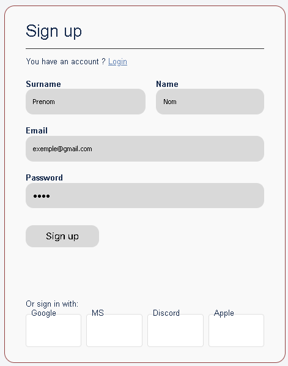

### 2.2. Connexion

1. L'utilisateur va sur `/login` ou clique sur **"Se connecter"**.
2. Il renseigne email et mot de passe.
3. Le frontend appelle `POST /auth/login` via `login()`.
4. Le backend vérifie les identifiants, pose un cookie signé, puis renvoie le profil utilisateur.
5. Le frontend stocke l'utilisateur dans `AuthContext` et redirige vers `/boards`.

>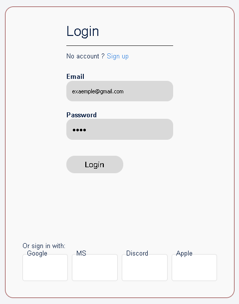

## 3. Parcours "Tableaux" (page `/boards`)

1. Au chargement, le frontend appelle `GET /board` via `getBoards()`.
2. L'utilisateur voit la liste de ses tableaux (nom, description éventuelle).
3. Il peut :
   - Cliquer sur un tableau pour l'ouvrir (`/boards/[boardId]`).
   - Cliquer sur **"Nouveau tableau"** pour en créer un :
     - Saisie du nom + description.
     - `POST /board` via `createBoard()`.
     - Un trigger SQL crée automatiquement les colonnes "TODO", "ON PROGRESS" et "DONE" ainsi qu'une première tâche d'exemple.[cite:63]

>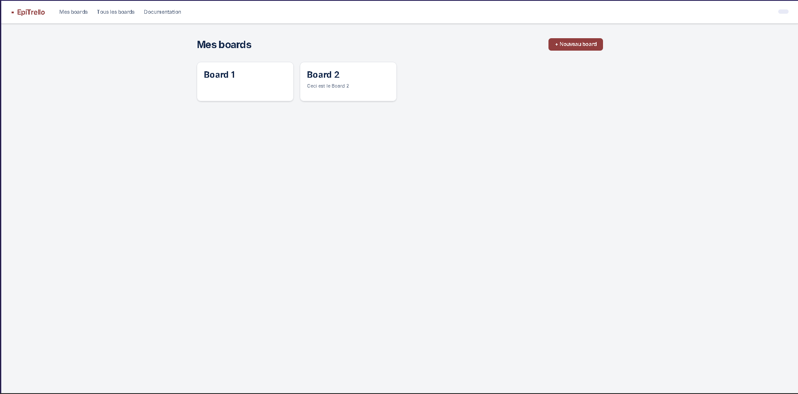

>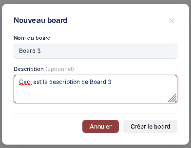

## 4. Parcours sur un board (vue Kanban `/boards/[boardId]`)

### 4.1. Chargement initial

Au montage de la page :

- `GET /board/:id` (via `getBoard()`) pour récupérer :
  - Métadonnées du board (nom, description, auteur, couleur de fond).
  - Colonnes (ordre, couleur, index).
  - Tâches et événements par colonne, avec assignés, tags et commentaires.
- `GET /boardParticipant/:boardId` (via `getParticipants()`) pour récupérer la liste des membres et leurs rôles.
- `GET /notifications` (via `getNotifications()`) puis polling toutes les 10 secondes.[cite:64]

Le rôle courant est déterminé comme suit :

- Si `createdBy === user.id` → rôle `admin`.
- Sinon, rôle issu de `BoardParticipant.role` (`admin`, `member`, `guest`).

> 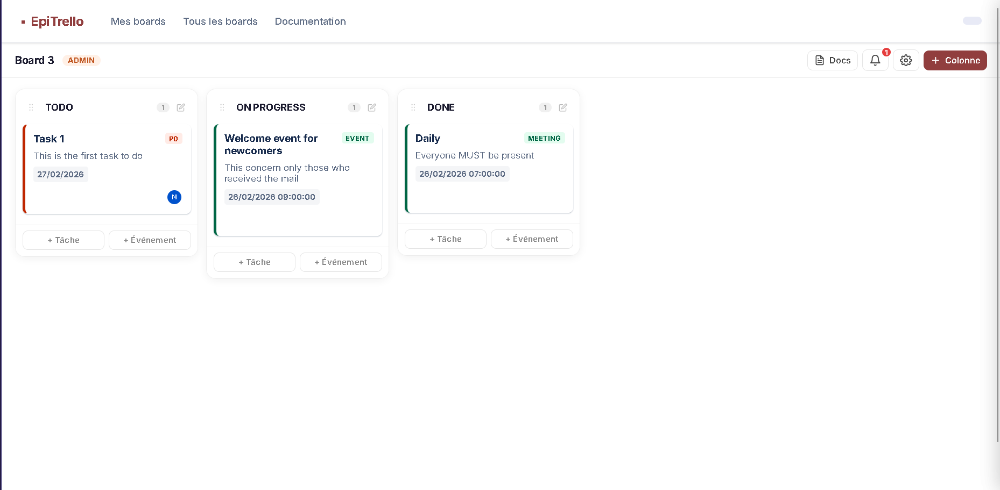

### 4.2. Gestion des colonnes

- **Créer une colonne** (admin uniquement) :
  - Clic sur **"Colonne"** → ouverture d'un modal.
  - Saisie du nom → `POST /boardColumn`.
  - La nouvelle colonne apparaît à droite.
- **Réordonner les colonnes** :
  - Drag & drop horizontal via dnd-kit.
  - À la fin du drag, le frontend recalcule `columnIndex` et envoie une série de `PUT /boardColumn/:id`.

> 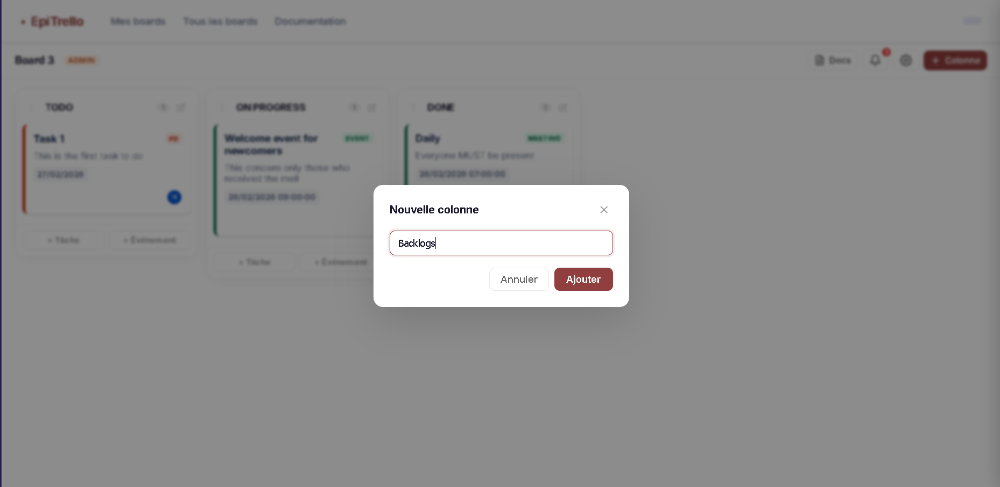

> - Animation de drag & drop des colonnes (`./images/08-dnd-columns.png`).

### 4.3. Tâches et événements

- **Créer une tâche** :
  - Dans une colonne, clic sur **"+ Tâche"**.
  - Saisie du titre, description, dates, priorité.
  - `POST /task` avec `boardColumnId` cible.
- **Créer un événement / meeting** :
  - Clic sur **"+ Événement"**.
  - Choix des dates, lieu, type (`event` ou `meeting`).
  - `POST /eventMeeting`.
- **Déplacer une carte** (tâche ou event) :
  - Drag & drop vertical ou vers une autre colonne.
  - Lors du drop, `PUT /task/:id` ou `PUT /eventMeeting/:id` avec le nouveau `boardColumnId`.
- **Détails d'une carte** :
  - Clic sur une carte → ouverture d'un modal de détail.
  - L'utilisateur peut :
    - Modifier le titre, la description, la priorité, les dates.
    - Ajouter des tags (`/tags`, `/cardTag`).
    - Assigner des membres (`/assignee`).
    - Ajouter des commentaires (`/comments`).

> 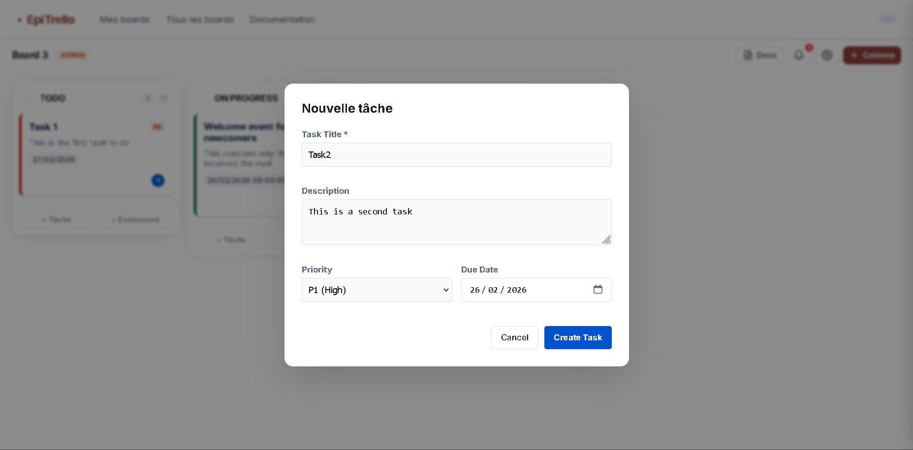

> 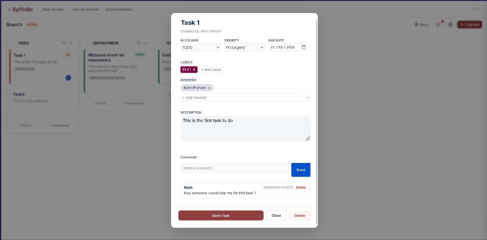

> 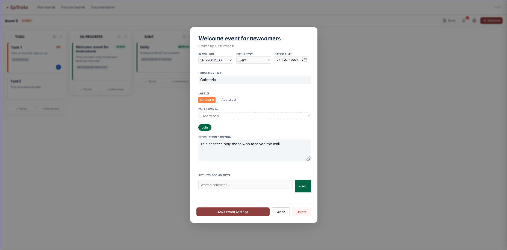

### 4.4. Notifications

1. Clic sur l'icône **Notifications** dans l'en-tête du board.
2. Ouverture d'un panneau latéral listant les notifications triées par date.
3. Pour chaque notification :
   - Affichage du message et de la date.
   - Bouton **"Marquer lu"** → `PUT /notifications/:id/read`.
4. Bouton **"Tout lire"** → `PUT /notifications/:id/read` en rafale pour toutes les notifications non lues.

> 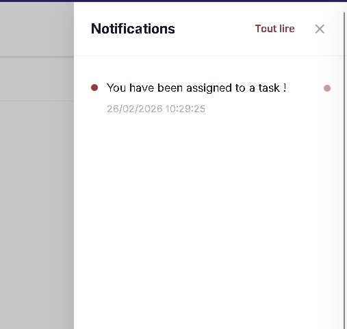

### 4.5. Paramètres du board (admin)

Clic sur l'icône **⚙️** ouvre un panneau latéral avec trois blocs :

1. **Fond du board** :
   - Sélecteur de couleur (color picker) permettant de choisir le `backgroundColor`.
   - Bouton **"Appliquer"** → `PUT /board/:id/settings`.

2. **Inviter un membre** :
   - Champ email + select rôle (`member` ou `admin`) + bouton **"Inviter"**.
   - `POST /boardParticipant/invite` → recherche de l'utilisateur par email, création d'une ligne `BoardParticipant`.
   - Un message de statut indique le succès ou l'erreur (déjà présent, utilisateur inexistant, etc.).

3. **Membres** :
   - Liste des membres (`BoardParticipant`) avec avatar, email et rôle.
   - Deux actions par ligne (admin uniquement) :
     - **Changer le rôle** : bascule `admin ↔ member` → `PUT /boardParticipant/:id`.
     - **Retirer du board** : `DELETE /boardParticipant/:id`.

> 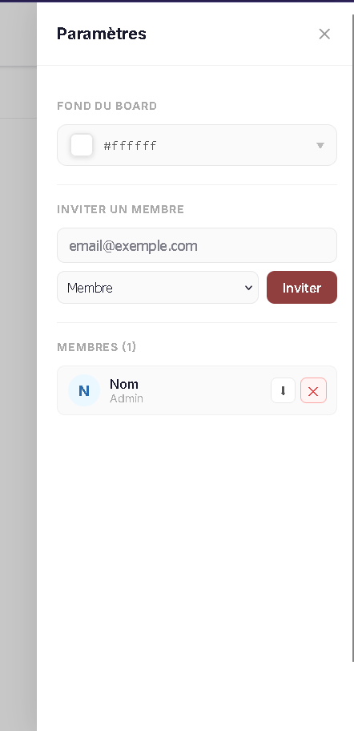

<!-- ## 5. Parcours documentation (`/boards/[boardId]/documentation`)

### 5.1. Navigation et chargement

1. Depuis la vue du board, clic sur le bouton **"Docs"** dans l'en-tête.
2. Redirection vers `/boards/[boardId]/documentation`.
3. Chargement initial : `GET /documentation?boardId=...` retourne la liste des documents pour ce board.
4. Le document sélectionné est affiché dans la partie droite (éditeur).

> 📸 **Capture suggérée** : mise en page générale de l'écran documentation (`./images/15-docs-main.png`).

### 5.2. Gestion des documents

- **Créer un document** :
  - Clic sur **"Nouveau document"** dans la sidebar.
  - Saisie du nom → `POST /documentation`.
  - Le document vide est immédiatement sélectionné dans l'éditeur.
- **Éditer un document** :
  - Titre éditable via un input.
  - Contenu texte (support Markdown) dans un textarea.
  - Autosave après 2 secondes sans frappe → `PUT /documentation/:id`.
  - Bouton **"Sauvegarder"** pour forcer une sauvegarde immédiate.
- **Supprimer un document** :
  - Icône poubelle sur la ligne du document → confirmation → `DELETE /documentation/:id`.

> 📸 **Captures suggérées** :
> - Création d'un nouveau document (`./images/16-doc-create.png`).
> - Édition d'un document avec contenu (`./images/17-doc-edit.png`). -->

## 6. Rôles et permissions

### 6.1. Rôles disponibles

- `admin` : accès complet au board (paramètres, gestion des membres, colonnes, etc.).
- `member` : peut créer/modifier des cartes, commenter, mais pas changer les paramètres ni la liste de membres.
- `guest` (si utilisé) : lecture seule ou droits limités suivant la configuration.

### 6.2. Matrice de permissions

| Action                                      | Admin | Member |
|---------------------------------------------|:-----:|:------:|
| Voir le board                               |  ✅   |   ✅   |
| Créer / modifier une tâche ou un événement  |  ✅   |   ✅   |
| Drag & drop des cartes                      |  ✅   |   ✅   |
| Ajouter / modifier une colonne              |  ✅   |   ❌   |
| Changer la couleur de fond du board         |  ✅   |   ❌   |
| Inviter des membres                         |  ✅   |   ❌   |
| Changer le rôle d'un membre                 |  ✅   |   ❌   |
| Retirer un membre du board                  |  ✅   |   ❌   |
| Créer / modifier des documents              |  ✅   |   ✅   |
